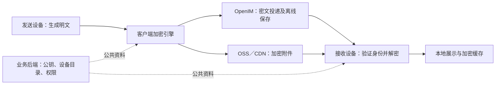

# IM 端到端加密开发方案

> 版本：V0.1，需求与开发评审稿  
> 日期：2026-10-29  
> 依据：客户提供的聊天记录、当前 IM 项目关键链路源码。  
> 状态：本文件为拟开发方案，不代表项目已经具备端到端加密能力；具体协议库、支持设备和排期在技术预研后冻结。

## 1. 客户需求理解

客户在聊天记录中反复强调“端对端”“每个用户有单独的解密密钥”“所有通讯加密”，期望达到“消息传输全程加密保护，守护你的每一段对话”的效果。

本方案将核心目标定义为：**聊天内容在发送方设备完成加密，经服务器传输、离线保存后，仅由会话中获得授权的接收设备解密；IM 服务器、业务服务器、对象存储和推送服务不持有解密聊天内容的秘密。**

需求理解需区分以下三类：

| 类别 | 本次理解 |
| --- | --- |
| 聊天记录已明确 | 需要通讯内容加密，希望不同用户拥有独立的解密能力，不使用写死在源码中的通用密钥 |
| 本方案建议覆盖 | 单聊、群聊，以及文字、图片、语音消息、视频消息、文件、引用、转发、收藏、多设备与离线消息 |
| 尚待确定 | “通话加密”是否还包括实时语音／视频通话；支持哪些平台及版本；历史恢复方式；是否所有会话默认启用 |

初步建议：新版本支持的单聊与群聊默认启用端到端加密；未满足条件的会话明确提示，不能自动改发明文。实时音视频作为独立交付项，在确认实际通话模块后实施。以下设计按这一建议展开，未将建议视为客户已确认的合同范围。

### 1.1 聊天记录中需要纠正的技术理解

- **“把密钥放服务端更安全”不适用于真正的端到端加密。** 服务器可以保存公钥、签名预密钥、设备目录，以及只有用户设备能解开的加密备份；不能保存可直接解密消息的私钥、会话密钥，或掌握备份的解密密码。
- **“每个账户一个密钥”只是通俗理解。** 实际应为账户下每台设备建立独立身份密钥，按会话和消息更新加密密钥，避免一个永久密钥保护所有历史消息。
- **“接口加密”与“端到端加密”分属不同层。** HTTPS／WSS 仍然必需，但不能据此宣称服务器无法读取聊天内容。
- **“不能破解”不能作为绝对承诺。** 端到端加密保护传输及服务端持有的内容；接收方截图、主动转发，或设备被控制后读取明文，不在它能阻止的范围内。

### 1.2 三种加密的区别

| 方式 | 加密和解密的位置 | 服务器能否读取内容 | 是否满足本次核心目标 |
| --- | --- | --- | --- |
| HTTPS／WSS 传输加密 | 客户端与 TLS 终止节点之间 | 能 | 仅是基础要求 |
| 数据库／OSS 服务端存储加密 | 服务器或存储系统内部 | 持有解密权限的服务能 | 不能替代端到端加密 |
| E2EE（End-to-End Encryption，端到端加密） | 会话参与者的授权设备 | 不能，仅持有密文 | 满足 |

“所有通讯加密”在本方案中指：所有网络连接使用安全传输，私密会话内容额外使用 E2EE。登录、好友关系、投递路由等需要服务器处理的业务数据，不因此变成服务器不可见。

## 2. 当前项目情况与改造依据

以下结论来自关键源码检查，不是线上抓包结论，也不构成对全部部署、原生插件和所有服务的完整审计。

| 现有位置 | 已确认的实现 | 加密改造要求 |
| --- | --- | --- |
| `IM-APP-fronend/package.json` | uni-app、Vue 3、Pinia，使用 OpenIM Web SDK 与 uni-app 适配层 | H5、Android、iOS 分别验证加密引擎和 SDK 能力 |
| `IM-APP-fronend/src/utils/openim.ts` | `sendTextMessage` 直接以文本创建 OpenIM 消息；统一发送入口为 `sendCreatedMessage` | 在明文进入 SDK 创建／上传流程之前增加加密处理 |
| 同上：`customMessageDataOf`、`sendMessagePinSync` | 已有自定义消息读取／发送，并处理 `customElem`／`CustomElem` | 评估用独立业务类型承载加密信封，保留现有自定义消息能力 |
| `IM-APP-fronend/src/stores/chat.ts` | 处理实时接收、离线同步及历史消息 | 加入异步解密、状态管理、去重和失败占位 |
| `IM-APP-fronend/src/utils/storage-upload.ts`、`file-upload.ts` | 附件上传入口 | 上传前加密，覆盖所有 SDK 自动上传及业务上传路径 |
| `IM-APP-fronend/src/utils/mediaApi.ts`、`openim.ts` 的 `sendVoiceMessage` | H5 语音上传到后端转码，异常时存在旧上传回退 | 加密会话必须改用本地编码／解码，不得回退上传明文 |
| `IM-APP-server/internal/service/voice_transcode.go` | 服务端使用 ffmpeg 转码语音 | E2EE 语音不能经过该明文处理链路 |
| `IM-APP-server/internal/service/forward.go` | 保存源消息快照，并由后台任务向目标发送内容 | 客户端为目标生成密文；后台只投递已生成的密文任务 |
| `IM-APP-server/internal/service/favorite.go` | 接收收藏内容，调用媒体归档能力 | 收藏正文、附件密钥和备注一起加密，归档仅复制密文 |
| `IM-APP-server/internal/handler/openim_webhook.go`、`internal/moderation/client.go` | 消息发送前存在内容审核；审核模块可将文本／图片信息提交第三方 | E2EE 内容不能继续通过这条明文审核链路 |
| `IM-APP-fronend/src/utils/openim.ts` 的 `offlinePushInfo` | 当前该入口使用通用推送标题，描述为空 | 保留通用通知，并核查其他推送入口及 SDK 默认行为 |

在本次检查的前后端主要目录和前端依赖中，未定位到实时音视频通话 SDK 或通话业务实现。不能直接假设已经具备可开启的“通话加密开关”，还需核对原生插件和其他交付项目。

## 3. 交付范围与安全边界

### 3.1 消息内容范围

| 功能 | 目标行为 |
| --- | --- |
| 单聊／群聊文字、表情、名片 | 内容在客户端加密，接收端解密后展示 |
| 图片／视频 | 原文件、缩略图、视频封面均加密；描述与相关密钥放入加密消息 |
| 语音消息 | 本地处理可播放格式后加密，接收端解密播放 |
| 文件 | 文件内容、原文件名、说明等敏感元数据加密 |
| 引用／回复／合并转发 | 引用正文、嵌套消息快照一并加密，不携带明文副本 |
| 转发／群发 | 发起设备为目标会话重新加密，不复用原会话信封 |
| 收藏／收藏备注 | 使用用户设备掌握的收藏加密密钥，服务器仅存密文 |
| 会话摘要／搜索 | 在本地解密后计算，服务端不生成明文摘要或全文索引 |
| 离线通知 | 默认只显示“收到一条新消息”，推送载荷不放正文和附件密钥 |
| 撤回／删除／已读 | 继续校验权限；必要控制消息需认证，撤回不承诺擦除对方已经保存的副本 |
| 实时音视频 | 独立模块，见第 9 节；语音消息加密不等于语音通话加密 |

### 3.2 仍然可能可见的信息

服务器为提供服务，仍可能看到用户／设备标识、投递对象、群成员关系、IP、发送时间、消息大小、投递和已读状态。是否隐藏更多元数据属于额外需求，不在“正文加密”中自动实现。

头像、公开昵称、公开公告等共享业务信息应单独划定范围；涉及聊天正文的群公告、置顶摘要或自定义通知，不能未经评审继续明文发送。

### 3.3 主要保护场景

保护网络窃听、消息密文被窃取、消息存储及对象存储泄露，以及服务端日常运维读取聊天内容的场景。身份校验机制还要防止服务端替换公钥后冒充收件设备。

H5 的代码由网站提供，恶意脚本或被篡改的前端发布可在加密前读取内容。因此 H5 必须配合 XSS 防护、依赖与发布管理；不能声称在网站发布方主动篡改客户端代码时仍拥有与独立安装包完全相同的安全边界。

## 4. 推荐架构与协议选择



### 4.1 职责划分

- **客户端**：密钥生成、安全保存、对端身份验证、加解密、附件处理、设备授权、加密历史及恢复。
- **业务后端**：鉴权、公钥目录、预密钥领取、设备撤销、群成员权限、密文任务和对象访问权限。
- **OpenIM**：继续负责消息路由、离线投递、排序、回执等，承载密文，不被当作自动提供 E2EE 的组件。
- **OSS／CDN**：仅保存和分发加密附件；访问鉴权、过期清理仍需保留。

### 4.2 技术选型原则

**采用成熟协议与经过审查的实现，不自行设计握手、密钥派生或消息棘轮算法。** 普通 AES 加密函数只能解决局部问题，不能代替设备身份、会话建立、密钥轮换和多设备协议。

| 场景 | 预研首选方向 | 必须验证 |
| --- | --- | --- |
| 单聊异步会话 | Signal 协议体系的成熟实现：预密钥握手、Double Ratchet、多设备会话管理 | 维护状态、许可证、Native／H5 绑定、离线握手、乱序和状态持久化 |
| 群聊 | 优先验证 MLS 1.0（RFC 9420）的成熟实现 | H5／原生支持、成员与设备绑定、离线成员追赶、群规模和 epoch 更新 |
| 附件 | 成熟库提供的认证加密／分块加密能力，例如 AES-256-GCM 或经过审查的流式加密方案 | nonce 唯一性、分块顺序认证、截断检测、跨端测试向量 |
| 网络连接 | HTTPS／WSS，部署支持时优先 TLS 1.3，并验证证书 | API、消息长连接、公钥分发、附件请求及内部边界 |

不在预研前承诺 `libsignal` 可直接作为 uni-app 的通用 npm 包使用；可能需要 Android／iOS 原生桥和 H5 WASM 适配。群聊若采用 Sender Keys 等替代方案，须重新说明成员变更、前向安全和泄露后恢复能力，不可将其与 MLS 的安全属性等同。

选型输出应冻结具体库、版本、密码套件、序列化格式及支持平台。不兼容的设备必须显示不支持，不得自动换用临时自研算法。

## 5. 账户、设备和密钥生命周期

### 5.1 密钥分类

| 对象 | 保存位置 | 管理规则 |
| --- | --- | --- |
| 设备身份私钥 | 设备安全存储 | 每台设备独立生成，不上传可解密形式 |
| 设备身份公钥／签名预密钥／一次性公钥 | 服务器公钥目录 | 供授权通信对象查询；签名和有效期由客户端验证 |
| 单聊会话状态／消息密钥 | 设备本地加密存储 | 由协议更新；按规范清除过期消息密钥，限制乱序缓存 |
| 群组 epoch 秘密 | 对应 epoch 的授权成员设备 | 成员及设备变化时按群协议更新，服务器不生成或掌握群秘密 |
| 附件随机密钥 | 发送设备及加密消息内部 | 每个附件独立，不能放入 URL、公开字段或日志 |
| 本地历史／收藏密钥 | 用户授权设备 | 与实时会话状态分离，支持明确授权的迁移与备份 |
| 备份恢复秘密 | 用户持有，或由已有设备传输 | 不通过账户登录密码或客服接口自动取得 |

### 5.2 首次使用和身份验证

1. 设备使用系统安全随机源生成密钥，建立本地加密存储。
2. 登录后登记设备公钥及协议能力，证明持有对应私钥；公钥记录绑定账户和设备。
3. 发送端获取对方授权设备列表，验证签名、有效期及已有身份记录。
4. 支持安全码／二维码核对。首次信任策略需明确告知；未经独立核对的首次公钥，仍存在目录服务被替换的信任风险。
5. 已验证身份发生变化时暂停向变化设备发送，提示用户核对；不能静默接受替换。

后续可引入可验证的密钥透明日志及一致性检查，增强对设备目录定向替换的发现能力；仅把目录查询接口改成 HTTPS 不足以解决此问题。

### 5.3 多设备与换机

- 一个账户可以有多个设备，各设备使用独立身份；发送时覆盖对方授权设备，以及发送者自己的其他授权设备。
- 新设备登录不等于自动取得聊天解密权限。建议由已有可信设备扫码授权；没有旧设备时，走用户持有的恢复秘密或明确的身份重置流程。
- 新设备是否获得历史消息必须显式授权。默认仅收取授权后的新消息；旧历史通过设备间加密迁移或加密备份恢复。
- 设备撤销后停止向其封装新消息，并更新相关群组 epoch；先前已下发的内容和密钥无法远程收回。
- 账户密码重置不能直接恢复 E2EE 私钥。全部可信设备和恢复秘密丢失时，旧加密历史无法恢复，应在产品内提前说明。

### 5.4 本地安全存储和恢复

- iOS 使用 Keychain，Android 使用 Keystore 保护本地密钥；不假设协议所需曲线均受硬件直接支持，可由硬件保护包装密钥，再加密保存协议状态。
- H5 评估 Web Crypto 与 IndexedDB；禁止将原始私钥写入 `localStorage`、普通 `uni` 缓存、Pinia 持久化或错误上报。不可导出的 `CryptoKey` 也不能抵御同源恶意脚本调用。
- 区分锁定、退出登录、切换账号、删除设备和清除数据；普通退出不应无提示销毁唯一恢复材料，切换账号必须清除当前内存明文。
- 发送序列、棘轮状态和待发送密文原子持久化，防止崩溃、重试和多标签页并发导致状态回退或密钥／nonce 重用。
- 加密历史、搜索索引、收藏和临时媒体都应有本地保护与清理策略。消息密钥按协议删除后，历史读取依赖本地加密档案，不应长期保留所有旧棘轮密钥。
- 可选云备份应在客户端加密，使用独立高强度恢复秘密；如使用用户口令，采用经审查的内存困难 KDF 和设备基准参数。登录口令、短信验证码不能成为备份解密后门。
- 不将实时棘轮状态克隆到另一台设备继续发送。恢复档案后建立新设备身份及新会话，避免回滚、设备克隆和状态重用；备份也会改变历史保密边界，必须单独说明。

## 6. 消息发送、接收与存储

### 6.1 单聊发送

1. 统一输入模型，涵盖文本、回复、名片、附件描述等，不先创建包含明文的 OpenIM 消息。
2. 获取并验证收件人与本人其他设备的授权清单，建立或恢复各设备间的加密会话。
3. 附件先完成本地处理与加密，再上传密文；附件描述和密钥放入待加密消息正文。
4. 使用协议引擎生成各目标设备可解密的载荷，构造有明确版本的加密信封。
5. 用 OpenIM 自定义消息发送信封。`description`、`extension`、`ex`、摘要、通知字段不得夹带原始内容。
6. 重试复用已持久化的同一份密文和逻辑消息 ID；如需要重新加密，则由协议安全推进状态并保持业务幂等。

### 6.2 接收与历史

实时消息、离线补拉、分页历史、搜索结果、转发预览和会话最新消息，都经过同一个加密消息识别层。先归一化平台字段，再进行结构校验、协议验证和异步解密，最后转换为 UI 模型。

解密状态至少包括 `pending`、`ready`、`missing_key`、`unsupported_version`、`verification_failed`。未知版本、密钥缺失或认证失败时展示明确占位和恢复入口，不把密文当正文、不无限重试、不自动改用明文。

SDK 原始消息与解密后的展示数据分离。禁止把解密结果回写到会被同步、上报或上传的 OpenIM 原始对象；本地明文摘要也不得再发送到服务端。

### 6.3 加密信封草案

下例只描述**单聊传输容器**，不是自研密码协议。`protocolMessage` 由选定的成熟协议引擎产生，包含其规定的消息头、密文与认证数据；群聊另按选定群协议定义载荷。

```json
{
  "businessKey": "e2ee_message",
  "version": 1,
  "suiteId": "selected-profile-v1",
  "logicalMessageId": "client-generated-id",
  "senderDeviceId": "device-a",
  "conversationBinding": "stable-logical-conversation-id",
  "deviceListVersion": 7,
  "deliveries": [
    {
      "recipientDeviceId": "device-b",
      "protocolMessage": "base64-encoded-protocol-output"
    }
  ]
}
```

约束：

- 所有影响安全判断的外层字段，都必须通过协议认证内容或 AAD（附加认证数据）绑定并交叉检查；不是仅在 JSON 外层写一个 ID。
- 绑定稳定的业务会话、发送设备、接收设备、协议版本和逻辑消息 ID，防止跨会话搬运或伪造发送者。服务端稍后生成的消息序号不能作为唯一认证依据。
- 不自定义棘轮消息头或手工拼装协议内部结构；规范化序列化和跨端测试向量必须一致。
- 加密信封与原有群邀请、置顶等自定义消息按明确 `businessKey` 分流，不能拦截所有自定义消息。
- 限制信封大小、设备数量、嵌套深度和乱序队列；服务端鉴权、客户端去重与协议防重放同时生效。
- 多设备载荷会增大消息体。预研须核查 OpenIM 各端限制及当前 webhook 的 `64 KiB` 请求体限制，不能无界扩大或用明文拆包兜底。

## 7. 群聊加密

群聊不能使用一个永久不变、由服务器分发的共享 AES 密钥。群成员账户与其授权设备都需要映射为协议参与者。

| 事件 | 处理规则 |
| --- | --- |
| 建群 | 创建初始加密群状态，将经过身份验证的设备加入 |
| 新成员／新设备加入 | 经权限及身份验证后加入新 epoch；默认不能读取加入前历史 |
| 成员退出／被移除 | 先提交成员变更并产生新 epoch，再发送后续群消息 |
| 设备撤销／身份重置 | 更新相关群状态，停止向失效设备提供新密钥材料 |
| 离线成员返回 | 获取并验证所需协议更新；无法追赶时重新加入，不从服务器领取明文群密钥 |
| 并发成员变更 | 按协议提交顺序和冲突恢复机制处理，服务器不能只改单个 epoch 数字 |

客户端核对群管理权限、签名和成员快照，不能仅相信服务端声称的新增设备。缓存旧成员目录时有竞态风险，需使用版本控制和失效通知，定义成员变更完成后才能继续发送的边界。

新成员默认不获得旧历史；若产品允许分享历史，由已有授权成员显式重新加密分享。移除成员不能消除其已经取得的历史副本。MLS、Sender Keys 等协议的前向安全及泄露后恢复条件，以实际选型和实现验证为准。

## 8. 附件、转发、收藏及既有功能调整

### 8.1 附件处理

发送端先生成缩略图、视频封面并完成必要压缩，再分别加密原件和预览文件。对象存储使用不含原始文件名的随机标识，原文件名、MIME、说明、时长等放入加密描述中；必要的外层大小和路由信息按元数据处理。

接收端取回密文，验证认证标签后才交给播放器或文件查看器。大文件使用成熟的分块方案，每块绑定文件标识、序号、总块数／结束标记，防止替换、重排和截断；绝不在同一密钥下重复 nonce。

H5 评估 Blob／Object URL、Worker 与内存上限；App 评估流式处理、应用私有目录临时文件及清理。保存到相册或用户目录属于主动导出解密副本，需要明确操作。CDN 缓存、缩略图服务和服务器转码不得再生成明文附件。

### 8.2 H5 语音跨端兼容

现有 H5 `webm/opus → 服务端 ffmpeg → m4a` 流程与 E2EE 冲突，不能先上传原始语音转码再加密。

预研应比较客户端编码、接收端解码支持及本地 WASM 转码的性能，确定 Android、iOS、Chrome、Safari 均可用的格式组合。兼容性未解决的客户端应提示暂不支持发送该类加密语音，不能回退到旧明文上传接口。

### 8.3 转发和群发

- 发起设备本地解密所选消息，为目标会话生成新消息和新加密载荷；不得上传明文 `sourceSnapshot`。
- 服务端任务仅保存目标与对应密文，负责排队、重试和状态查询；客户端离线后，只能继续发送已准备好的密文。
- 新增目标、目标设备变更或群 epoch 失效时，需要客户端重新准备载荷，服务端不能替用户生成新的解密授权。
- 附件转发第一版建议用新附件密钥重新加密并上传，明确区分源附件和新副本的权限、保留期及删除行为。
- 大量转发需要限流、批次持久化和断点续传，工作量不等同于给后台任务增加一个布尔开关。

### 8.4 收藏、搜索和内容审核

| 功能 | E2EE 后的处理 |
| --- | --- |
| 收藏正文／备注 | 在客户端加密为独立收藏条目，密钥与原会话棘轮分离 |
| 收藏附件归档 | 服务端可复制密文字节，不能获得附件密钥；保留期与原消息清理解耦 |
| 聊天搜索 | 在授权设备本地建立受保护的索引；云端历史全文搜索不能原样保留 |
| 链接预览 | 禁止服务器自动获取私密消息中的 URL 生成摘要；需单独选择本地预览或关闭 |
| 第三方内容审核 | 不再自动提交私密聊天原文／图片；任何主动提交都会扩大明文接收方范围 |
| 举报 | 用户主动选择并确认提交的证据，作为明确披露给处理方的独立流程 |
| 运维排障／发送失败审计 | 记录错误码、耗时和必要标识，不记录明文、密钥、解密快照 |

**当前审核策略必须列为产品和发布评审项。** 代码中 `APP_STORE_READY` 与 `CONTENT_MODERATION_ENABLED` 存在启动约束。应设计 E2EE 私密会话、公开内容、举报处置各自的治理方式并同步配置和文档，不通过直接关闭全部审核或让加密消息偷偷提交明文来“兼容”。审核策略在生产环境是否开启，需另外核验。

## 9. 实时语音／视频通话

本节仅在客户确认包含实时通话时进入交付，不将它与语音条、视频文件混为一项。

1. 先确认实际 RTC SDK、原生插件及 P2P／SFU／MCU 拓扑，验证各端支持的媒体帧加密 API。
2. WebRTC 的 DTLS-SRTP 保障对应传输链路；是否达到参与者之间的 E2EE，要看加密终点及身份认证。SFU 终止传输加密后，仍需额外的端到端帧加密；普通 TURN 中继不等同于媒体解密节点。
3. 优先使用所选 RTC SDK 经过验证的 E2EE／SFrame 等能力，通话密钥通过已认证的端到端通道分发，不能由业务服务器明文发放。
4. 密钥绑定通话实例、参与设备和媒体方向；重连、设备替换和参与者进退需要更新并验证状态，避免复用或误投密钥。
5. 群通话按成员变化轮换密钥；不支持 E2EE 的参与设备应被阻止加入加密通话，不能静默降级整个房间。
6. 云录制、云转写、混流和服务端内容分析通常需要明文，无法原样与服务器不可解密的目标并存。若引入录制机器人，它就是新增的明文接收方，必须明确显示并授权。

验收不仅检查通话能接通，还应确认 RTC 中转／媒体服务无法获取可播放的音视频内容，并验证丢包、弱网、后台切换和轮换期间的音画连续性。

## 10. 开发模块与接口草案

### 10.1 前端模块

建议新增 `IM-APP-fronend/src/security/e2ee/`，将协议引擎适配、设备身份、会话状态、加密存储、信封与附件处理分离。纯密码逻辑放普通 TypeScript／原生模块；Vue composable 只负责 UI 状态与生命周期，不在页面组件中实现算法。

| 现有／拟新增位置 | 工作内容 |
| --- | --- |
| `src/security/e2ee/`（拟新增） | 封装成熟协议库，提供设备、会话、群组及附件能力，定义跨端测试向量 |
| `src/api/e2ee.ts`（拟新增） | 公钥、设备、预密钥、策略及恢复接口 |
| `src/utils/openim.ts` | 分平台创建密文自定义消息，接入发送、接收、历史和摘要处理 |
| `src/stores/chat.ts` | 管理解密队列、展示数据、状态和去重；不持有可序列化私钥 |
| `src/utils/chatMedia.ts` 及相关媒体工具 | 解密媒体解析、预览、播放、保存及临时文件生命周期 |
| `src/utils/forwardSnapshot.ts`、`src/stores/forward.ts` | 生成目标专属密文任务，防止明文快照上传 |
| `src/composables/chatMessageActions/favoriteActions.ts` | 加密收藏及归档流程 |
| 聊天安全状态／设备管理／身份核对页面（拟新增） | 展示会话状态、管理授权设备、处理换机和安全码核对 |

UI 边界：`ConversationSecurityStatus` 仅接收安全状态并触发查看详情；`DeviceList` 仅展示设备并发出授权／撤销事件；`IdentityVerification` 展示核对资料并提交用户确认。容器／composable 协调业务服务，组件不通过 props 接收原始私钥。

必须统一兼容 `customElem`／`CustomElem`、`data`／`Data`，以及既有媒体字段的 camelCase／PascalCase。H5 可用的方法不能直接假定 App 原生桥也可用；App 加密桥可能需要更新原生安装包，不能只交付 WGT 热更新。

### 10.2 后端数据设计草案

| 拟新增／调整的数据 | 核心内容与约束 |
| --- | --- |
| `e2ee_devices` | 账户、设备、公钥、签名、能力、授权状态、撤销时间；账户和设备联合唯一 |
| `e2ee_prekeys` | 签名预密钥及一次性公钥；领取原子化，支持幂等请求，不重复发给不同握手 |
| `e2ee_conversation_policies` | 会话模式、最低版本、策略版本和切换边界；不保存会话秘密 |
| `e2ee_group_events` | 经认证的群协议更新／成员事件及版本，按协议权限投递；不保存群秘密 |
| `e2ee_device_events` | 设备授权、撤销、身份变化的审计记录；只存必要元数据 |
| `e2ee_backups`（可选） | 客户端加密档案、版本、校验信息和配额；不保存恢复秘密 |
| 收藏／转发／附件现有表 | 增加协议版本、密文状态、对象引用；禁止继续写明文内容副本 |

实际迁移编号按开发时仓库最新版本分配。密码学秘密不进入数据库、Redis、Kafka 任务、审计表或监控日志；队列里仅存可公开的路由信息和密文。

### 10.3 API 草案

遵守当前后端约定：查询使用静态路径 `GET`，参数放 query；写操作使用静态路径 `POST`，全部业务参数放 JSON body。鉴权凭证放请求头。以下均为拟新增接口。

| 方法与路径 | 用途 |
| --- | --- |
| `GET /api/v1/e2ee/devices?userId=...` | 查询有权通信的对象的授权设备、公钥及目录版本 |
| `POST /api/v1/e2ee/devices/register` | 登记设备公钥、能力及持有证明，后端按授权流程设置状态 |
| `POST /api/v1/e2ee/devices/authorize` | 已有可信设备批准新设备，校验挑战、签名及有效期 |
| `POST /api/v1/e2ee/devices/revoke` | 撤销设备并触发目录失效及群状态更新 |
| `POST /api/v1/e2ee/prekeys/upload` | 上传公钥预密钥包，校验签名、配额和有效期 |
| `POST /api/v1/e2ee/prekeys/claim` | 原子领取握手公钥包；有消费状态，不能设计为 `GET` |
| `GET /api/v1/e2ee/conversations/policy?conversationId=...` | 查询当前会话策略和版本 |
| `POST /api/v1/e2ee/conversations/enable` | 校验参与设备能力后发起启用流程，客户端验证协商结果 |
| `POST /api/v1/e2ee/groups/events` | 按所选群协议提交成员／设备变更事件及版本 |
| `GET /api/v1/e2ee/groups/events?groupId=...&afterVersion=...` | 拉取该设备获准取得的群协议更新 |
| `POST /api/v1/e2ee/backups/save`（可选） | 保存客户端已加密的备份及元信息 |
| `GET /api/v1/e2ee/backups?backupId=...`（可选） | 鉴权后获取密文备份资料 |

预密钥领取需要会话授权、限流、幂等与防耗尽机制；设备授权不能仅靠一个长期登录 token；群协议事件需校验操作者权限、版本冲突及可投递对象。首次设备登记、设备全丢后的身份重置应作为明确流程，不能伪装成旧身份续用。

附件复用经过适配的上传凭证与完成接口；业务控制请求仍用 JSON，二进制密文通过预签名 URL 直传对象存储。API、OpenAPI、Postman 与测试同步更新。

## 11. 兼容、历史及灰度发布

1. **能力协商**：以设备为单位记录协议和媒体能力。已有安全状态由客户端固定并验证，防止服务器把能力描述改为空就触发明文发送。
2. **旧客户端**：新客户端检测到不兼容设备时阻止启用或发送；启用后的会话服务端拒绝旧的明文发送路径。兼容提示可改善体验，但不能靠占位文字解决安全问题。
3. **模式切换**：协商明确生效边界，处理尚未发送、已排队和离线客户端消息。客户端保留已验证的启用状态，服务器回滚配置不能取消该状态。
4. **历史数据**：启用前的消息明确标记为旧消息，不追溯宣称 E2EE。历史转存需由有权设备加密；即使清理服务器旧副本，也不能保证过去的备份和已分发副本不存在。
5. **账号与群范围**：灰度按明确账户／会话开启，不允许同一条消息给部分设备发密文、给另一些设备发明文。
6. **异常与回退**：密钥服务、加密引擎或媒体解码异常时暂停受影响发送并可重试。回退可停止新增启用、回滚 UI 或修复服务，但必须保留已有密文、协议读取能力和密钥状态，不降级为明文。
7. **发布顺序**：先上线兼容的后端和密文存储，再分发带加密能力的客户端；完成各端互通后灰度启用。涉及原生桥时安排安装包升级和最低版本限制。

## 12. 开发阶段与交付物

| 阶段 | 工作包 | 完成条件 |
| --- | --- | --- |
| P0：需求与技术预研 | 明确平台、群规模和通话范围；选择协议库；验证 H5／Android／iOS 的单聊握手、媒体编解码及 MLS 可行性 | 输出版本矩阵、许可证检查、互通样例、性能基线和正式工作量估算 |
| P1：设备与密钥基础 | 设备身份、安全存储、公钥目录、预密钥、身份核对、撤销与多端授权 | 不可导出明文私钥到服务端；换机、撤销和身份变化流程可验证 |
| P2：单聊消息 | 文本、名片、引用、自定义信封、离线／历史、去重和推送 | 各端互通，服务器仅持有密文，旧客户端不造成降级 |
| P3：媒体与群聊 | 加密附件、语音跨端、缩略图、群协议、成员与设备变化 | OSS 仅有密文；成员变化后权限隔离正确；大文件和群规模达标 |
| P4：业务闭环 | 转发、群发、收藏、本地搜索、治理流程、历史迁移；可选备份 | 没有明文旁路，既有业务按明确规则完成替换或限制 |
| P5：安全验证与发布 | 协议测试向量、故障测试、独立安全评审、原生真机回归、灰度与恢复演练 | 验收清单通过，完成问题修复和交付记录 |
| P6：实时通话（条件项） | RTC 选型、帧加密、身份／密钥分发、群通话轮换 | 参与设备互通且媒体服务器无法读取内容 |

P0 建议安排约 5～10 个工作日作为探索时间盒，不是保证完成所有跨端适配的固定工期。完整排期需要在协议库绑定、原生开发工作量、群规模、历史恢复及通话范围确定后估算。生产交付需覆盖客户端／原生、后端、QA 和安全评审职责；仅做“文字 AES 加解密演示”不能作为本方案完成标准。

P2 可作为内部单聊试点；只有 P3、P4、P5 相应范围通过后，才能对外宣称覆盖完整消息业务。实时通话未完成时，宣传文案不得包含通话已实现 E2EE 的暗示。

## 13. 验收清单

### 13.1 安全与内容边界

- [ ] 在测试环境检查 TLS 终止后的消息请求、OpenIM 存储、业务库、队列、日志、审计及第三方推送，均无测试聊天明文或解密秘密；不能仅靠网络抓包看到 TLS 密文判定成功。
- [ ] 对象存储和 CDN 取得的附件、缩略图、封面不能直接播放或查看，持有 URL 也不能取得明文。
- [ ] 服务端人员只拥有服务器配置、数据库、对象存储和日志时，不能恢复聊天正文。
- [ ] 篡改密文、认证标签、发送设备、目标会话或协议版本均被拒绝；错误消息不导致崩溃或无限重试。
- [ ] 重放、乱序、重复回调、跨会话搬运和预密钥并发领取不会产生身份混淆、重复消费或状态破坏。
- [ ] 首次身份核对、对端公钥替换、未授权新增设备和设备撤销均有预期结果；不能靠服务端注入设备窃取后续消息。
- [ ] 成员／设备移除完成并切换新 epoch 后，不能解密新消息；新增成员默认不能解密旧历史。
- [ ] 重试、崩溃重启、H5 多标签页、备份恢复不会重用密钥／nonce 或回滚发送状态。
- [ ] 源码、安装包、配置、错误上报和调试日志不含通用解密密钥；私钥不写入普通前端缓存。
- [ ] 旧 API、转发快照、收藏、引用、置顶、审核、链接预览和语音转码均未形成明文旁路。

### 13.2 业务与跨端

- [ ] H5 ↔ H5、Android ↔ Android、iOS ↔ iOS，以及三平台之间的双向收发均通过。
- [ ] Chrome／Safari、最低支持系统与实际原生桥版本有明确测试矩阵；小程序等未验收平台不会误标支持。
- [ ] 文字、图片、语音、视频、文件、名片、引用、转发、收藏均可正确收发和展示。
- [ ] `camelCase`／`PascalCase` 字段、原生进度回调、自定义消息及非加密系统通知保持兼容。
- [ ] 多设备、离线补拉、分页历史、重连、撤回、已读和群成员变更符合约定。
- [ ] 换机、丢失设备、恢复秘密遗失、浏览器清除站点数据时，不出现虚假的“历史已恢复”。
- [ ] 解密失败有用户可理解的提示，加密未成功不会显示“已安全发送”。
- [ ] 退群、销号、切换账号和本地临时文件清理不会暴露前一账号的明文数据。

### 13.3 性能与验证方式

P0 冻结支持的最大群成员数、每账户设备数、最大文件、最低内存设备及消息延迟预算。后续记录发送／接收加密耗时的 p50／p95、首条握手耗时、历史批量解密耗时、原生峰值内存和附件额外流量，按这些预算验收，不能先省略加密后补性能结果。

实施后运行相关协议测试、前端单元测试与类型检查、H5／App 构建、Go 单元与集成测试；构建成功不替代浏览器互通和 Android／iOS 真机测试。测试使用专用环境与测试账号，不以真实聊天内容作为日志样本。独立评审重点覆盖协议使用、密钥生命周期和所有明文旁路。

## 14. 开发前需要确认的产品决策

| 决策 | 建议默认值 | 对开发的影响 |
| --- | --- | --- |
| “通讯”范围 | 单聊和群聊全部私密消息类型；实时通话单列确认 | 决定是否增加 RTC 工程 |
| 端支持范围 | Android、iOS、H5；小程序等按实际需求另验 | 决定协议绑定与测试矩阵 |
| 启用策略 | 支持设备的新会话默认开启，旧设备阻止降级 | 影响升级提示和历史共存 |
| 多设备与新机历史 | 独立设备身份；旧设备授权；历史显式迁移 | 影响设备管理和恢复体验 |
| 云备份 | 首版可不做，保留安全迁移；需要时采用用户持有恢复秘密的备份 | 影响历史恢复和保密边界 |
| 群成员变更 | 新成员不看旧历史，离开成员不看后续消息 | 决定群协议行为和测试 |
| 服务端可见性 | 运维／客服不具备普遍解密聊天能力 | 与现有内容审核、检索和代发逻辑需同步调整 |
| 旧明文消息 | 保留明确标记，不冒充已受 E2EE 保护 | 如要求迁移／清理，需另排数据工程 |
| 群与文件容量 | 沿用产品现有目标，P0 核实并冻结具体上限 | 决定协议性能、信封大小和测试规模 |

这些项目用于需求评审和后续排期，不影响先完成本开发方案。

## 15. 对外说明建议

在对应范围通过验收后，可使用以下描述：

> 已启用端到端加密的会话中，消息内容在发送设备上加密，仅由会话参与者的授权设备解密。传输与离线存储过程中，服务器处理的是加密内容。设备变更与身份验证状态可在会话安全设置中查看。

“消息传输全程加密保护，守护你的每一段对话”可作为宣传摘要，但需同时展示适用范围。避免“绝对无法破解”“后台可随时恢复全部聊天”“所有历史消息已自动加密”等与实际能力不符的承诺。

## 16. 协议参考

- Signal Double Ratchet：<https://signal.org/docs/specifications/doubleratchet/>
- Signal PQXDH：<https://signal.org/docs/specifications/pqxdh/>
- Signal Sesame 多设备会话管理：<https://signal.org/docs/specifications/sesame/>
- MLS 1.0，RFC 9420：<https://www.rfc-editor.org/rfc/rfc9420.html>
- SFrame，RFC 9605：<https://www.rfc-editor.org/rfc/rfc9605.html>

以上是设计参考，不表示当前 SDK 已实现这些规范，也不代表已验证某个第三方库适用于本项目。以 P0 的库版本、许可证和跨端互通结果确定最终实现。
